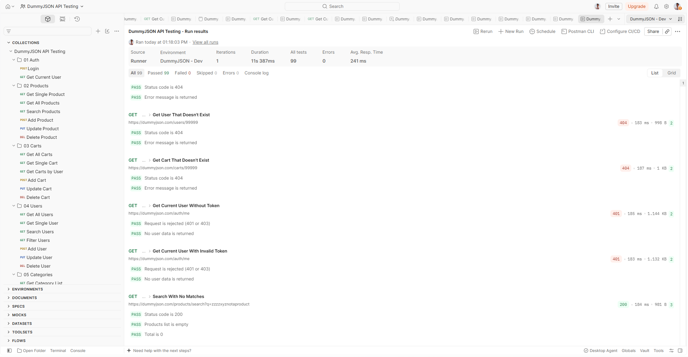
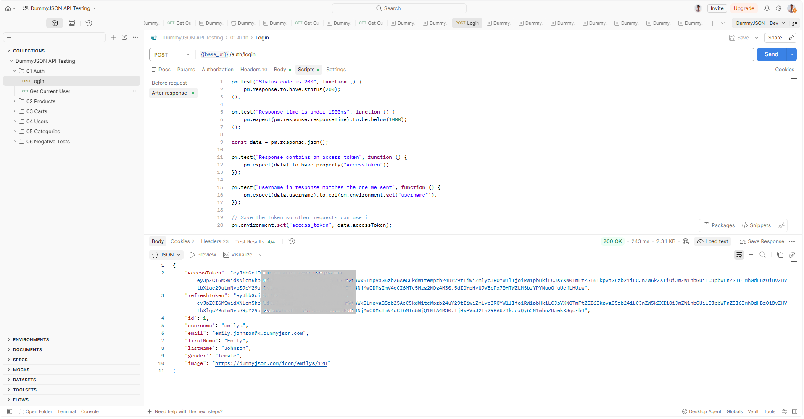
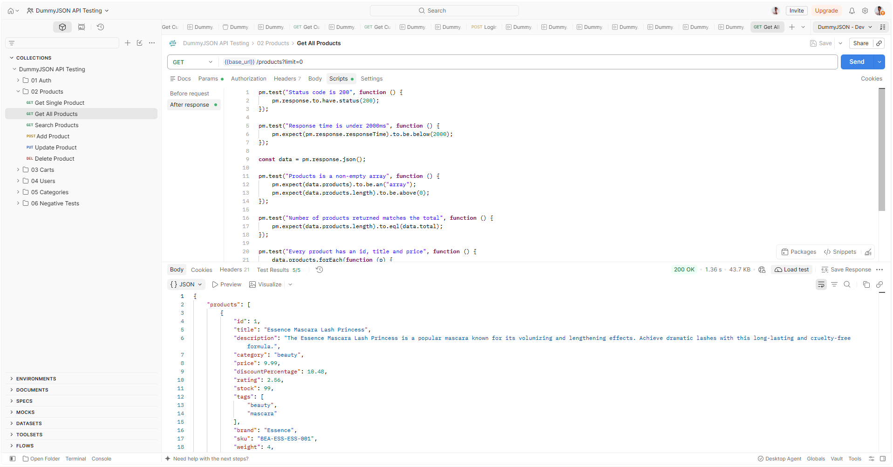
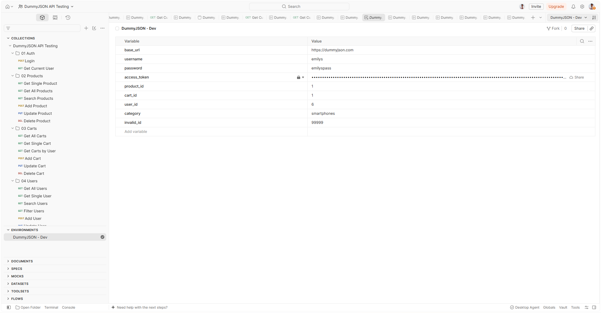

# DummyJSON API Testing with Postman

An automated API test suite for the public [DummyJSON](https://dummyjson.com) REST API, built with Postman.



## Overview

| | |
|---|---|
| **Folders** | 6 |
| **Requests** | 31 |
| **Assertions** | 99 (all passing) |
| **Tool** | Postman (Collection Runner) |
| **API under test** | [dummyjson.com](https://dummyjson.com) |

The suite covers authentication, full CRUD flows, search, filtering, pagination, and negative scenarios. It uses environment variables, request chaining, and business-logic assertions rather than only checking status codes.

## What is covered

| Folder | Requests | Tests | What it checks |
|---|---|---|---|
| `01 Auth` | 2 | 7 | Login, token saved for later requests, current-user lookup |
| `02 Products` | 6 | 23 | Single product, all products (`limit=0`), search, add, update, delete |
| `03 Carts` | 6 | 19 | List, single cart, carts by user, add, update, delete |
| `04 Users` | 7 | 24 | List, single user, search, filter, add, update, delete |
| `05 Categories` | 3 | 10 | Category list, detailed categories, products by category |
| `06 Negative Tests` | 7 | 16 | Wrong password, missing resources, missing and invalid tokens, empty search |

## Key features

- **Environment variables:** `base_url`, `username`, `password`, `product_id`, `cart_id`, `user_id`, `category`, `invalid_id`, so no values are hardcoded in requests.
- **Request chaining:** the `Login` request saves the access token to the environment, and later requests send it automatically as a Bearer token.
- **Beyond status codes:** assertions check field presence, data types, ID matching, and business logic (for example, a cart's `totalProducts` equals the length of its products list, and the discounted total is never above the total).
- **Completeness checks:** `Get All Products` and `Get All Users` compare the number of items returned with the `total` reported by the API.
- **Filter checks:** results are verified item by item (for example, every user returned by the hair-colour filter has the requested colour).
- **Negative and edge cases:** 400 and 404 responses, missing and invalid tokens, and a search with no matches.

### Token chaining



### Example assertions



## Results by folder

| Folder | Screenshot |
|---|---|
| 01 Auth | [results-01-auth.png](screenshots/results-01-auth.png) |
| 02 Products | [results-02-products.png](screenshots/results-02-products.png) |
| 03 Carts | [results-03-carts.png](screenshots/results-03-carts.png) |
| 04 Users | [results-04-users.png](screenshots/results-04-users.png) |
| 05 Categories | [results-05-categories.png](screenshots/results-05-categories.png) |
| 06 Negative Tests | [results-06-negative.png](screenshots/results-06-negative.png) |

### Environment setup



## How to run it

1. Download or clone this repository.
2. Open Postman and **import** the files in `collection/` and `environment/`.
3. Select the **DummyJSON - Dev** environment (top right).
4. Add `dummyjson.com` to the allowlist: **Cookies, then Manage Cookies, then Domain Allowlist**. The collection-level pre-request script needs this permission to clear cookies (see Findings below).
5. Right-click the collection, choose **Run**, and keep these two settings:
   - tick **Run collection without using stored cookies**
   - untick **Save cookies after collection run**
6. Click **Run**. `Login` runs first and saves the token for the requests that need it.
The `access_token` variable is not included in the environment file. `Login` creates it automatically when it runs.

## Findings and notes

**1. Cookie state affected the "no token" test.**
After `Login`, DummyJSON also sets the token as a cookie, and Postman re-sent it on later requests. As a result, `Get Current User Without Token` returned `200` instead of the expected `401`. The Postman Console showed that my first cookie-clearing script was failing, because `{{base_url}}` was not resolved inside the script. The fix was to allowlist `dummyjson.com` and clear cookies in a collection-level pre-request script that resolves variables first with `pm.variables.replaceIn(...)`.

**2. A passing test that proves nothing.**
My first version of the user filter test used `value=brown` (lowercase). DummyJSON's filter is case-sensitive, so it returned an empty list. The "every user has brown hair" test still passed, because a loop over an empty list never fails. I paired it with a "returns at least one user" test, and used `value=Brown`.

**3. DummyJSON simulates writes.**
Add, update, and delete requests return realistic responses, but nothing is stored. The tests therefore check the echoed response (for example, `isDeleted: true` and `deletedOn`) and do not try to fetch the changed record afterward.

**4. Search checks are loose by design.**
The product search test confirms the term appears somewhere in a result's text (for example, "headphones" contains "phone"), since the API's exact matching rules are not documented.

## Repository structure

```
postman-dummyjson/
├── README.md
├── collection/      Postman collection (v2.1)
├── environment/     Postman environment
└── screenshots/     Run results and examples
```

## Author

**Tanvir Ahmed**
